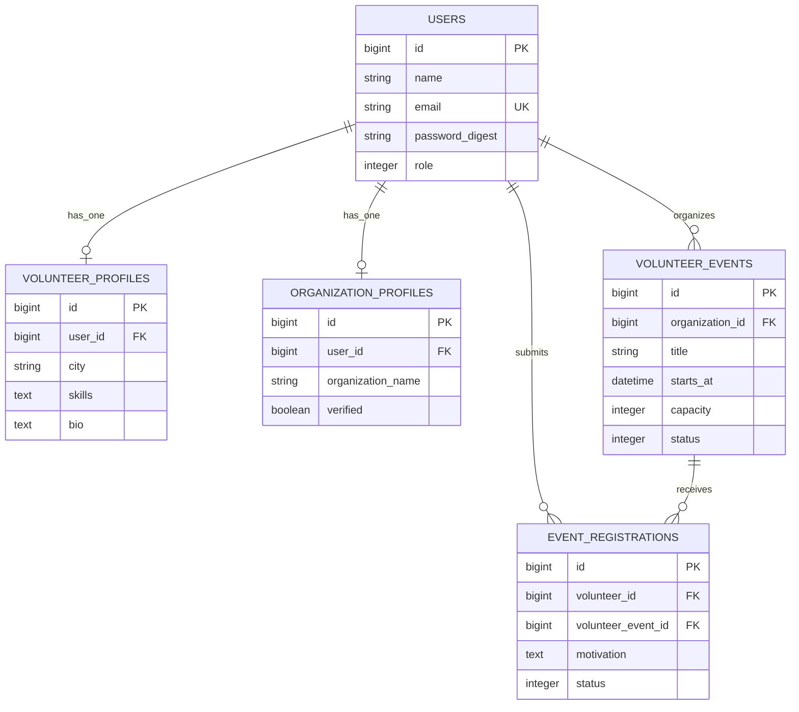

> **Catatan:** Panduan belajar ini ditulis saat proyek masih memakai Rails 7.0.
> Sejak itu aplikasi sudah di-upgrade ke Rails 8.1 dan mendapat fitur baru
> (konfirmasi email, reset password, verifikasi organisasi, notifikasi email).
> Untuk instalasi dan deploy terbaru, lihat [README](../README.md).

# VolunteerMatch

VolunteerMatch adalah aplikasi web Ruby on Rails yang mempertemukan relawan
dengan organisasi penyelenggara kegiatan sosial. Organisasi dapat membuat
kegiatan dan mengelola pendaftar. Relawan dapat mencari kegiatan, mendaftar,
memantau status, dan membatalkan pendaftaran.

README ini sekaligus menjadi dokumentasi teknis, panduan belajar, petunjuk
instalasi Windows, dan catatan workflow Git/GitHub proyek.

## Daftar Isi

1. [Fitur](#fitur)
2. [Teknologi](#teknologi)
3. [Fundamental Ruby dan Rails](#fundamental-ruby-dan-rails)
4. [Arsitektur aplikasi](#arsitektur-aplikasi)
5. [Database](#database)
6. [Model dan fungsinya](#model-dan-fungsinya)
7. [Controller dan fungsinya](#controller-dan-fungsinya)
8. [Routes](#routes)
9. [Views dan UI](#views-dan-ui)
10. [Instalasi Windows](#instalasi-windows)
11. [Perintah Ruby dan Rails](#perintah-ruby-dan-rails)
12. [Workflow Git dan GitHub](#workflow-git-dan-github)
13. [Testing](#testing)
14. [Keamanan](#keamanan)
15. [Troubleshooting](#troubleshooting)
16. [Riwayat dan roadmap](#riwayat-dan-roadmap)

## Fitur

### Pengguna umum

- Melihat kegiatan yang telah dipublikasikan.
- Membuka detail kegiatan tanpa login.
- Mencari berdasarkan judul atau deskripsi.
- Memfilter berdasarkan kategori, lokasi, dan tanggal.

### Relawan

- Registrasi dan login sebagai `volunteer`.
- Mengisi profil, kota, telepon, keahlian, ketersediaan, dan bio.
- Mendaftar kegiatan dengan menulis motivasi.
- Memantau status `Pending`, `Accepted`, `Rejected`, atau `Cancelled`.
- Membatalkan pendaftaran yang masih aktif.
- Melihat riwayat pendaftaran melalui dashboard.

### Organisasi

- Registrasi dan login sebagai `organization`.
- Mengisi profil organisasi.
- Membuat, membaca, memperbarui, dan menghapus kegiatan.
- Mengelola status `Draft`, `Published`, `Closed`, atau `Cancelled`.
- Melihat daftar relawan yang mendaftar.
- Menerima atau menolak pendaftaran.
- Hanya mengelola kegiatan milik organisasinya sendiri.

### Aturan bisnis

- Password minimal delapan karakter.
- Email dinormalisasi menjadi lowercase dan harus unik.
- Waktu selesai harus sesudah waktu mulai.
- Deadline harus sebelum waktu mulai.
- Kapasitas harus berupa integer lebih dari nol.
- Relawan tidak boleh mendaftar dua kali pada kegiatan yang sama.
- Pendaftaran hanya dibuka untuk event published, sebelum deadline dan waktu
  mulai, serta selama kapasitas penerimaan belum penuh.
- Organisasi tidak dapat mendaftar sebagai relawan.
- Jumlah relawan accepted tidak dapat melebihi kapasitas.

## Teknologi

| Teknologi | Versi dan fungsi |
|---|---|
| Ruby | 3.3.2, bahasa utama |
| Ruby on Rails | 7.0.10, framework web MVC |
| PostgreSQL | 18, database relasional |
| Active Record | ORM antara Ruby dan PostgreSQL |
| Puma | Web server Rails |
| bcrypt | Hashing password melalui `has_secure_password` |
| Sprockets | Asset pipeline CSS |
| Turbo/Stimulus | Fondasi frontend Rails |
| Minitest | Unit dan integration testing |
| Git/GitHub | Version control, branch, Pull Request |

Minitest dibatasi pada versi `< 6` karena Rails 7.0 memakai API runner yang
tidak kompatibel dengan Minitest 6.

## Fundamental Ruby dan Rails

### Class dan object

```ruby
class User < ApplicationRecord
end

user = User.new(name: "Relawan")
```

`User` adalah class. `user` adalah object atau instance. Model mewarisi
`ApplicationRecord` agar memperoleh kemampuan database Active Record.

### Variable dan tipe data

```ruby
name = "Relawan"                # String
age = 20                        # Integer
active = true                   # TrueClass
skills = ["Ruby", "Desain"]    # Array
profile = { city: "Bandung" }   # Hash
```

Gunakan `.class` untuk mengetahui tipe object. Ruby menghasilkan `NameError`
jika variable belum pernah dibuat.

### Method

```ruby
def logged_in?
  current_user.present?
end
```

Method adalah fungsi di dalam class. Tanda `?` adalah konvensi Ruby untuk
method yang mengembalikan kondisi benar atau salah.

### Symbol, hash, dan block

```ruby
event = { status: :published, capacity: 20 }

skills.each do |skill|
  puts skill
end
```

- `status:` adalah key hash.
- `:published` adalah symbol.
- Bagian `do ... end` adalah block yang dijalankan untuk setiap item.

### MVC

```text
Browser -> Route -> Controller -> Model -> PostgreSQL
                       |
                       v
                     View -> HTML/CSS -> Browser
```

- **Model**: data, association, validation, dan aturan bisnis.
- **View**: HTML/ERB yang dilihat pengguna.
- **Controller**: menerima request, memanggil model, memilih response.
- **Route**: memetakan URL dan HTTP verb ke action.
- **Migration**: riwayat perubahan struktur database.

### ERB

```erb
<h1><%= @event.title %></h1>

<% if logged_in? %>
  <p>Anda sudah login.</p>
<% end %>
```

- `<%= ... %>` menampilkan hasil Ruby.
- `<% ... %>` menjalankan Ruby tanpa menampilkannya.

## Arsitektur Aplikasi

```text
app/
|-- assets/stylesheets/application.css   Sistem desain responsif
|-- controllers/                         Request dan authorization
|-- models/                              Data dan aturan bisnis
`-- views/                               Template HTML/ERB
config/
|-- database.yml                         Koneksi PostgreSQL
|-- routes.rb                            URL aplikasi
`-- environments/                       Konfigurasi tiap environment
db/
|-- migrate/                             Riwayat perubahan database
`-- schema.rb                            Struktur database terbaru
test/
|-- controllers/                         Integration test
|-- models/                              Model test
`-- test_helper.rb                       Konfigurasi test
```

### Alur login

1. Form mengirim email dan password ke `SessionsController#create`.
2. Email dibersihkan dengan `strip.downcase`.
3. `User.find_by` mencari pengguna.
4. `authenticate` membandingkan password dengan hash bcrypt.
5. `reset_session` menghapus session lama.
6. ID pengguna disimpan pada `session[:user_id]`.
7. `current_user` membaca ID itu pada request berikutnya.

### Alur pendaftaran kegiatan

1. Relawan membuka event published.
2. `registration_open?` memeriksa deadline, waktu, dan kapasitas.
3. Relawan mengirim motivasi.
4. Registration dibuat dengan status `pending`.
5. Pemilik event menerima atau menolak pendaftar.
6. Kapasitas diperiksa lagi saat status berubah menjadi accepted.
7. Status baru tampil pada dashboard relawan.

## Database



Foreign key menjaga agar relasi menunjuk ke record yang ada. Unique index pada
email mencegah akun ganda. Unique index pada kombinasi event dan volunteer
mencegah pendaftaran ganda, termasuk ketika request datang hampir bersamaan.

## Model dan Fungsinya

### `User`

Lokasi: `app/models/user.rb`.

| Kode | Fungsi |
|---|---|
| `has_secure_password` | Membuat password, confirmation, dan authenticate memakai bcrypt |
| `has_one :volunteer_profile` | Satu relawan memiliki satu profil |
| `has_one :organization_profile` | Satu organisasi memiliki satu profil |
| `has_many :volunteer_events` | Organisasi memiliki banyak event |
| `has_many :event_registrations` | Relawan memiliki banyak pendaftaran |
| `registered_volunteer_events` | Mengambil event melalui registration |
| `enum role` | volunteer=0, organization=1, admin=2 |
| `normalize_email` | Menghapus spasi dan membuat email lowercase |

Validasi memastikan nama, role, dan email tersedia; email unik dan valid;
password minimal delapan karakter. `dependent: :destroy` membersihkan data
terkait ketika user dihapus.

### `VolunteerProfile`

- `belongs_to :user`: profil wajib memiliki user.
- `user_id` unik: satu user hanya memiliki satu volunteer profile.
- Menyimpan telepon, kota, bio, skills, dan availability.

### `OrganizationProfile`

- `belongs_to :user` dan `user_id` unik.
- `organization_name` wajib diisi.
- `verified` default `false` dan tidak tersedia pada strong parameters
  organisasi, sehingga organisasi tidak bisa memverifikasi dirinya sendiri.

### `VolunteerEvent`

Relasi `organization` menunjuk ke model `User` melalui `organization_id`.
Event memiliki banyak registration dan registered volunteers.

Enum status:

```ruby
draft: 0
published: 1
closed: 2
cancelled: 3
```

| Method | Fungsi |
|---|---|
| `upcoming` | Published dan mulai setelah sekarang, urut waktu |
| `matching_text(query)` | Mencari judul/deskripsi memakai PostgreSQL `ILIKE` |
| `in_category(category)` | Filter kategori exact |
| `in_location(location)` | Filter lokasi case-insensitive |
| `starting_on(date)` | Filter satu hari penuh |
| `registration_open?` | Memeriksa published, deadline, start, dan kapasitas |
| `remaining_capacity` | Kapasitas dikurangi jumlah accepted, minimum nol |
| `organization_account_required` | Pemilik harus role organization |
| `ends_after_start` | Selesai harus sesudah mulai |
| `registration_closes_before_start` | Deadline harus sebelum mulai |

`sanitize_sql_like` membuat karakter `%` dan `_` dari input pencarian tidak
berubah menjadi wildcard SQL yang tidak diinginkan.

### `EventRegistration`

Enum status:

```ruby
pending: 0
accepted: 1
rejected: 2
cancelled: 3
```

| Method/validasi | Fungsi |
|---|---|
| Motivation | Wajib, maksimum 1.000 karakter |
| Unique volunteer + event | Mencegah pendaftaran ganda |
| `volunteer_account_required` | Hanya akun volunteer |
| `event_must_accept_registrations` | Event harus masih terbuka saat create |
| `capacity_must_be_available` | Accepted tidak boleh melebihi kapasitas |
| `being_accepted?` | Validasi kapasitas hanya saat status berubah ke accepted |

## Controller dan Fungsinya

### `ApplicationController`

| Method | Fungsi |
|---|---|
| `current_user` | Membaca user dari `session[:user_id]` dan menyimpan hasil query |
| `logged_in?` | True jika current user tersedia |
| `require_login` | Guest diarahkan ke login |
| `require_organization` | Membatasi action untuk organization |
| `require_volunteer` | Membatasi action untuk volunteer |

`helper_method` membuat `current_user` dan `logged_in?` tersedia pada view.

### `UsersController`

- `new` menyiapkan object untuk form registrasi.
- `create` menyimpan akun atau merender error validasi.
- `PUBLIC_ROLES` hanya mengizinkan volunteer dan organization.
- `user_params` adalah strong parameters. Manipulasi role menjadi admin akan
  dikembalikan ke volunteer.

### `SessionsController`

- `new` menampilkan login; user yang sudah login diarahkan ke dashboard.
- `create` mencari email dan memanggil `authenticate` dari bcrypt.
- `destroy` menjalankan `reset_session` dan mengarahkan ke login.
- `reset_session` juga mencegah session fixation.

### `DashboardController`

Semua request memerlukan login. Dashboard relawan memakai `includes` untuk
mengambil event bersama registration dan mencegah query N+1.

### `ProfilesController`

- `current_profile` memilih volunteer atau organization profile.
- Jika profile belum ada, association `build_*_profile` membuat object baru.
- `profile_params` memberi daftar field berbeda untuk setiap role.
- Field `verified` sengaja tidak diizinkan untuk organisasi.

### `VolunteerEventsController`

| Action/method | Fungsi |
|---|---|
| `index` | Daftar upcoming, search/filter, kategori, dan event milik organisasi |
| `show` | Detail event, form relawan, atau daftar pendaftar pemilik |
| `new/create` | Membuat event melalui association current organization |
| `edit/update/destroy` | Mengelola event milik organisasi yang login |
| `parsed_filter_date` | Memproses tanggal ISO dan mengabaikan tanggal invalid |
| `set_visible_event` | Draft hanya dapat dilihat pemilik |
| `set_owned_event` | Mencari event melalui association pemilik |
| `event_params` | Strong parameters untuk field event |

Pencarian event melalui `current_user.volunteer_events.find` adalah bagian
authorization: organisasi lain tidak dapat mengubah event yang bukan miliknya.

### `EventRegistrationsController`

| Action/method | Fungsi |
|---|---|
| `create` | Membuat registration dan menetapkan volunteer dari current user |
| `accept/reject` | Keputusan hanya oleh pemilik event |
| `cancel` | Pembatalan hanya oleh pemilik registration |
| `require_event_owner` | Mencegah organisasi lain mengelola pelamar |
| `require_registration_owner` | Mencegah relawan membatalkan milik orang lain |
| `decide` | Hanya registration pending yang dapat diproses |
| `update_status` | Menyimpan status atau menampilkan error model |

ID volunteer tidak diambil dari form. Server selalu memakai `current_user`,
sehingga pengguna tidak dapat mendaftarkan akun orang lain dengan memanipulasi
parameter browser.

## Routes

Lokasi: `config/routes.rb`.

| HTTP | URL | Controller action | Fungsi |
|---|---|---|---|
| GET | `/` | `users#new` | Halaman registrasi |
| GET | `/users/new` | `users#new` | Form akun |
| POST | `/users` | `users#create` | Simpan akun |
| GET | `/login` | `sessions#new` | Form login |
| POST | `/login` | `sessions#create` | Buat session |
| DELETE | `/logout` | `sessions#destroy` | Hapus session |
| GET | `/dashboard` | `dashboard#show` | Dashboard |
| GET | `/profile` | `profiles#show` | Detail profil |
| GET | `/profile/edit` | `profiles#edit` | Form profil |
| PATCH | `/profile` | `profiles#update` | Update profil |
| GET | `/volunteer_events` | `volunteer_events#index` | Daftar/search/filter |
| GET | `/volunteer_events/:id` | `volunteer_events#show` | Detail event |
| GET | `/volunteer_events/new` | `volunteer_events#new` | Form event |
| POST | `/volunteer_events` | `volunteer_events#create` | Buat event |
| GET | `/volunteer_events/:id/edit` | `volunteer_events#edit` | Edit event |
| PATCH/PUT | `/volunteer_events/:id` | `volunteer_events#update` | Update event |
| DELETE | `/volunteer_events/:id` | `volunteer_events#destroy` | Hapus event |
| POST | `/volunteer_events/:event_id/event_registrations` | `event_registrations#create` | Daftar event |
| PATCH | `.../event_registrations/:id/accept` | `event_registrations#accept` | Terima |
| PATCH | `.../event_registrations/:id/reject` | `event_registrations#reject` | Tolak |
| PATCH | `.../event_registrations/:id/cancel` | `event_registrations#cancel` | Batalkan |

`GET` membaca, `POST` membuat, `PATCH` memperbarui, dan `DELETE` menghapus.
Lihat route aktual dengan:

```powershell
bundle exec rails routes
```

## Views dan UI

Layout utama berada di `app/views/layouts/application.html.erb`. Semua halaman
dirender pada `<%= yield %>`. Layout menyediakan navbar, flash message, content
container, dan footer.

Sistem desain berada di `app/assets/stylesheets/application.css`:

- CSS variables untuk warna dan ukuran konsisten.
- Grid dan Flexbox untuk layout.
- Navbar berbeda untuk guest dan user login.
- Card, panel, badge status, error summary, dan empty state.
- Breakpoint tablet dan mobile.
- Focus state pada input untuk aksesibilitas.
- Tidak memakai framework CSS eksternal, sehingga fundamental CSS mudah
  dipelajari.

Sprockets development/test menggunakan memory cache untuk menghindari error
file locking Windows `Permission denied @ rb_file_s_rename`.

## Instalasi Windows

### Prasyarat

Periksa tool:

```powershell
ruby --version
bundle --version
rails --version
git --version
& "C:\Program Files\PostgreSQL\18\bin\psql.exe" --version
```

Versi proyek: Ruby 3.3.2, Rails 7.0.10, PostgreSQL 18. Docker tidak diperlukan
karena PostgreSQL berjalan sebagai Windows Service.

```powershell
Get-Service postgresql-x64-18
```

Jika berhenti, jalankan PowerShell sebagai Administrator:

```powershell
Start-Service postgresql-x64-18
```

### Clone pada komputer baru

```powershell
Set-Location E:\project
git clone https://github.com/ivanjessiccaprihandana/VolunteerMatch.git
Set-Location E:\project\VolunteerMatch
bundle install
```

`bundle install` membaca Gemfile dan memasang dependency sesuai Gemfile.lock.
Jangan menjalankan `rails new .` karena aplikasi sudah tersedia.

### Environment password PostgreSQL

Password tidak disimpan pada repository. Atur pada setiap terminal PowerShell
yang akan menjalankan Rails atau test:

```powershell
$securePassword = Read-Host "Password PostgreSQL" -AsSecureString
$env:VOLUNTEERMATCH_DATABASE_PASSWORD = [System.Net.NetworkCredential]::new("", $securePassword).Password
Remove-Variable securePassword
```

Periksa tanpa menampilkan password:

```powershell
Test-Path Env:VOLUNTEERMATCH_DATABASE_PASSWORD
```

Hasil harus `True`. Uji password langsung:

```powershell
$env:PGPASSWORD = $env:VOLUNTEERMATCH_DATABASE_PASSWORD
& "C:\Program Files\PostgreSQL\18\bin\psql.exe" `
  -h 127.0.0.1 -U postgres -d postgres `
  -c "SELECT current_user;"
Remove-Item Env:PGPASSWORD
```

### Siapkan database

```powershell
bundle exec rails db:create
bundle exec rails db:migrate
bundle exec rails db:migrate RAILS_ENV=test
```

- `db:create`: membuat database development dan test.
- `db:migrate`: menjalankan migration yang belum up.
- Migration test diperlukan agar schema test sesuai development.

### Jalankan aplikasi

```powershell
Set-Location E:\project\VolunteerMatch
bundle exec rails server
```

Buka `http://127.0.0.1:3000`. Hentikan dengan `Ctrl + C`.

## Perintah Ruby dan Rails

### IRB untuk fundamental Ruby

```powershell
irb
```

```ruby
name = "Relawan"
age = 20
active = true
name.class
age.class
active.class

skills = ["Ruby", "Komunikasi"]
skills.each { |skill| puts skill }

user = { name: name, age: age }
user[:name]
```

Keluar menggunakan `exit` atau `Ctrl + D`.

### Rails console

```powershell
bundle exec rails console
```

```ruby
User.count
User.pluck(:name, :email, :role)
VolunteerEvent.published.count
VolunteerEvent.upcoming.pluck(:title, :starts_at)
EventRegistration.group(:status).count
```

Console berguna untuk memeriksa object dan query tanpa membuat halaman. Keluar
dengan `exit`.

### Database dan migration

```powershell
bundle exec rails db:migrate:status
bundle exec rails db:migrate
bundle exec rails db:rollback
bundle exec rails db:rollback STEP=2
```

- `migrate:status`: menampilkan migration up/down.
- `rollback`: membatalkan migration terakhir.
- `STEP=2`: membatalkan dua migration.

Perintah berikut menghapus database lokal dan bersifat destruktif:

```powershell
bundle exec rails db:drop db:create db:migrate
```

Gunakan hanya jika memang ingin menghapus seluruh data development.

### Generator, route, dan server

```powershell
bundle exec rails generate model Example name:string
bundle exec rails generate controller Examples index show
bundle exec rails routes
bundle exec rails server
bundle exec rails server -p 3001
```

Generator hanya membuat file awal. Developer tetap harus memeriksa migration,
association, validation, controller, route, view, dan test.

## Workflow Git dan GitHub

### Konfigurasi identitas

Dilakukan satu kali pada komputer:

```powershell
git config --global user.name "Nama GitHub"
git config --global user.email "email-github@example.com"
git config --global --list
```

Gunakan email yang terhubung ke GitHub agar commit dikenali pada contribution
calendar.

### Membuat repository lokal dari awal

Hanya untuk folder yang belum memiliki `.git`:

```powershell
git init
git branch -M main
git remote add origin https://github.com/USERNAME/REPOSITORY.git
```

Jangan menjalankan `git init` kembali pada repository yang sudah memiliki
folder `.git`.

### Memulai feature branch

```powershell
git switch main
git pull origin main
git switch -c feature/nama-fitur
```

Alasannya:

- `main` menyimpan versi stabil.
- Feature branch mengisolasi perubahan.
- Pull Request memungkinkan pemeriksaan sebelum merge.

Periksa pekerjaan:

```powershell
git status
git diff
```

Setelah fitur selesai dan test lulus:

```powershell
git add .
git commit -m "Add descriptive feature name"
git push -u origin feature/nama-fitur
```

- `git add .`: memasukkan perubahan ke staging area.
- `git commit`: menyimpan snapshot lokal.
- `git push -u`: mengirim branch dan mengatur upstream.

Di GitHub:

1. Klik **Compare & pull request**.
2. Pastikan base `main` dan compare branch fitur.
3. Periksa **Files changed**.
4. Klik **Create pull request**.
5. Setelah siap, klik **Merge pull request** lalu **Confirm merge**.
6. Hapus branch remote yang sudah selesai.

Sinkronkan lokal setelah merge:

```powershell
git switch main
git pull origin main
git branch -d feature/nama-fitur
git fetch --prune
git status
```

`git fetch --prune` membersihkan referensi branch remote yang sudah dihapus.

### Pesan commit yang baik

Contoh commit proyek:

```text
Add secure user registration
Add user sessions and protected dashboard
Add volunteer and organization profiles
Add organization-managed volunteer events
Add volunteer event registrations
Add volunteer event search and filters
Add responsive application UI
Document project setup and architecture
```

Hindari pesan umum seperti `update` atau `fix` karena tidak menjelaskan hasil.

### LF dan CRLF

Pesan ini aman pada Windows:

```text
LF will be replaced by CRLF the next time Git touches it
```

Itu adalah normalisasi line ending, bukan kegagalan `git add`.

### Menyimpan dokumentasi ini

Pada branch UI saat ini:

```powershell
git add README.md
git commit -m "Document project setup and architecture"
git push
```

Jika Pull Request branch sudah terbuka, push baru otomatis memperbarui PR yang
sama. Tidak perlu membuat PR kedua.

## Testing

### Testing otomatis

Pastikan environment password aktif, lalu:

```powershell
bundle exec rails test
```

Hasil valid terakhir:

```text
53 runs, 136 assertions, 0 failures, 0 errors, 0 skips
```

Arti output:

- `runs`: jumlah test method.
- `assertions`: jumlah kondisi yang diperiksa.
- `failures`: program berjalan, tetapi hasil tidak sesuai harapan.
- `errors`: test berhenti karena exception.
- `skips`: test sengaja dilewati.

Menjalankan file tertentu:

```powershell
bundle exec rails test test/models/user_test.rb
bundle exec rails test test/models/volunteer_event_test.rb
bundle exec rails test test/controllers/volunteer_events_controller_test.rb
bundle exec rails test test/controllers/event_registrations_controller_test.rb
```

Menjalankan test pada baris tertentu:

```powershell
bundle exec rails test test/models/user_test.rb:29
```

Test model memeriksa association, validation, tanggal, kapasitas, duplikasi,
search, dan filter. Integration test memeriksa response, redirect, session,
authorization, CRUD, dan HTML menggunakan `assert_select`.

Test dibuat sequential pada Windows. Saat suite melewati threshold 50, parallel
fixture loading pernah menyebabkan konflik transaksi PostgreSQL. Untuk suite
kecil ini, kestabilan lebih penting daripada paralelisasi.

### Testing manual

Gunakan browser normal untuk organisasi dan Incognito untuk relawan.

1. Buat akun organisasi dan login.
2. Lengkapi profil organisasi.
3. Buat event masa depan berstatus Published.
4. Buat akun relawan di Incognito.
5. Lengkapi profil, cari event, lalu mendaftar.
6. Organisasi menerima atau menolak pendaftaran.
7. Relawan memeriksa perubahan status pada dashboard.
8. Uji pembatalan.
9. Uji search dan seluruh filter.
10. Uji tampilan dengan memperkecil browser seperti ukuran HP.

Validasi yang perlu diuji:

- Email tanpa `@`.
- Password kurang dari delapan karakter.
- Judul kosong.
- Kapasitas nol.
- Waktu selesai sebelum waktu mulai.
- Deadline setelah waktu mulai.
- Motivation kosong.
- Relawan membuka `/volunteer_events/new`.
- Organisasi lain mencoba mengedit event yang bukan miliknya.

Input invalid harus menghasilkan pesan/redirect yang benar, bukan exception.

## Keamanan

- Password user disimpan sebagai hash bcrypt, bukan plain text.
- Password PostgreSQL berasal dari environment variable.
- Session di-reset saat login/logout.
- Strong parameters membatasi field dari browser.
- Form publik tidak dapat membuat admin.
- Authorization dipisahkan berdasarkan role dan kepemilikan.
- Registration selalu memakai current user.
- Draft hanya terlihat oleh pemilik.
- Unique index menjaga integritas pada level database.
- Input pencarian di-escape dengan `sanitize_sql_like`.
- Organisasi tidak dapat mengubah status verified sendiri.

Jangan commit password, token, API key, file credential, atau data pribadi.

## Troubleshooting

### Environment password tidak ditemukan

```text
key not found: "VOLUNTEERMATCH_DATABASE_PASSWORD"
```

Atur password pada terminal yang sama dengan terminal Rails/test:

```powershell
$securePassword = Read-Host "Password PostgreSQL" -AsSecureString
$env:VOLUNTEERMATCH_DATABASE_PASSWORD = [System.Net.NetworkCredential]::new("", $securePassword).Password
Remove-Variable securePassword
```

Environment variable PowerShell tidak otomatis pindah ke terminal baru.

### Password authentication failed

Periksa service dan port:

```powershell
Get-Service postgresql-x64-18
& "C:\Program Files\PostgreSQL\18\bin\pg_isready.exe" -h 127.0.0.1 -p 5432
```

Uji password langsung dengan `psql`. Jika lupa password, proses reset lokal
harus dilakukan dengan hati-hati:

1. Backup `pg_hba.conf`.
2. Ubah sementara baris `host all all 127.0.0.1/32` dari `scram-sha-256`
   menjadi `trust`.
3. Restart PostgreSQL.
4. Masuk dengan psql dan jalankan `\password postgres`.
5. Keluar menggunakan `\q`.
6. **Wajib** kembalikan `trust` menjadi `scram-sha-256`.
7. Restart lagi dan uji password baru.

Jangan meninggalkan mode `trust` aktif.

### `psql` tidak dikenali

```powershell
& "C:\Program Files\PostgreSQL\18\bin\psql.exe" --version
```

Path dengan spasi perlu call operator `&`. Mengetik path folder saja tidak
menjalankan program.

### Gemfile tidak ditemukan

```text
Could not locate Gemfile or .bundle/ directory
```

Pindah ke folder proyek:

```powershell
Set-Location E:\project\VolunteerMatch
bundle exec rails server
```

### Pending migration

```powershell
bundle exec rails db:migrate
bundle exec rails db:migrate RAILS_ENV=test
```

Development dan test memakai database terpisah.

### Permission denied cache Sprockets

```text
Permission denied @ rb_file_s_rename ... tmp/cache/assets/sprockets
```

Development dan test sudah memakai `Sprockets::Cache::MemoryStore`. Restart
server agar konfigurasi baru terbaca.

### Minitest wrong number of arguments

Rails 7.0 tidak kompatibel dengan Minitest 6 pada runner ini. Gemfile membatasi:

```ruby
gem "minitest", ">= 5.1", "< 6"
```

Lalu jalankan:

```powershell
bundle update minitest
bundle exec rails test
```

### `rails new .` ditolak

```text
Can't initialize a new Rails application within the directory of another
```

Itu berarti folder sudah merupakan aplikasi Rails. Jangan membuat aplikasi
kedua; lanjutkan dengan `bundle install`, migration, atau server.

## Riwayat dan Roadmap

### Riwayat branch

| Branch | Hasil |
|---|---|
| `feature/user-model` | User, bcrypt, role, dan validation |
| `feature/user-registration` | Registrasi volunteer/organization |
| `feature/user-sessions` | Login, logout, session, dashboard |
| `feature/user-profiles` | Profil kedua role |
| `feature/volunteer-events` | CRUD event organisasi |
| `feature/event-registrations` | Daftar, terima, tolak, batalkan |
| `feature/event-search` | Search dan filter |
| `feature/ui-design` | UI responsif dan cache Windows |

### Roadmap

- Admin dashboard untuk verifikasi organisasi dan moderasi event.
- Seed/demo data.
- Email notification untuk status pendaftaran.
- Pagination daftar event dan pelamar.
- Upload logo/foto dengan Active Storage.
- Attendance dan jam relawan.
- Sertifikat relawan.
- System test Capybara/Selenium.
- GitHub Actions CI.
- Deployment production.

---

Proyek ini dibangun dengan pendekatan learning by doing. Setiap fitur dipisah ke
branch, dilengkapi aturan bisnis dan test, lalu digabungkan melalui Pull Request
setelah stabil.
<!-- End of documentation. -->
